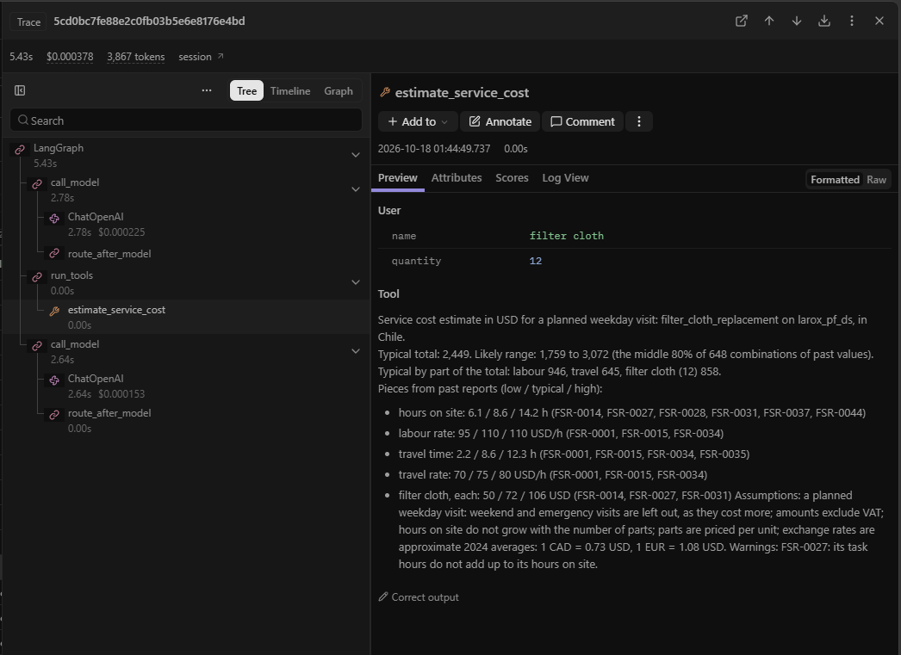

# Metso sales assistant agent

A command-line assistant for a Metso salesperson on a call with a mining customer. For each
message it decides for itself whether to answer, ask one short question, or use a tool, and
it says so when the answer is not in its data.

- **Products:** answers questions and recommends a product, from the brochures only.
- **Service costs:** estimates a field service visit, from past service reports only.
- **Flotation (optional part):** judges concentrate readings against plant history.


Every step, decision, measurement and limit is logged in [docs/TRACKER.md](docs/TRACKER.md).

## Quick start

Needs [uv](https://docs.astral.sh/uv/). Copy the assignment's `data/` folder into the
repository root (it is not part of the repository), or point `DATA_DIR` in `.env` at it.

```bash
uv sync
cp .env.example .env              # then add your OPENAI_API_KEY
uv run sales-assistant check      # checks the data folder and the key
uv run sales-assistant ingest     # prepares brochure pages, product cards and service records
uv run sales-assistant search "filter performance when the feed changes"
uv run sales-assistant ask "We have Larox pressure filters but performance drops whenever our feed grade changes"
uv run sales-assistant ask "A customer in Chile needs 12 filter cloths replaced on a Larox PF-DS tower press. What should I budget for the service visit?"
uv run sales-assistant estimate larox_pf_ds filter_cloth_replacement Chile --part "filter cloth" --quantity 12
uv run sales-assistant ask "The customer is getting 3.1% silica and 64.5% iron in their concentrate. They think that's normal. What do you think, and what could we suggest?"
uv run sales-assistant assess 64.5 3.1     # iron %, silica %
uv run sales-assistant chat       # a conversation; type exit to leave
```

`search`, `estimate` and `assess` show what the agent's three tools find, without the model.

## How the agent works


Each question runs a loop of two steps: in `call_model` the model answers, asks, or requests
tools; `run_tools` runs them and hands the results back. The routing rule,
`route_after_model`, picks the next step, and the CLI prints every tool call.

A plain loop would also work, in about 20 lines. The graph is that loop, with our own nodes
and routing rule rather than LangGraph's prebuilt agent, and it adds what a loop would need
written by hand: memory per conversation, a 12-step cap, each step streamed as it finishes,
and tracing of every step.



With [Langfuse](#tracing-optional) set up, every question is traced like this one: a model
call, the cost tool, and a model call, each with its time, tokens and cost.

## How the data is prepared


`ingest` runs once. Code reads the brochure pages; the model writes a card per brochure and
fills a form per service report, which code checks, flagging every gap without filling it
in. The results are saved for later runs; `ingest --rewrite` makes them again.

## How product questions are answered

`search_product_docs` ranks brochure pages by keyword (BM25), optionally within named
brochures, so product codes such as PF-DS match exactly; 22 of 24 test questions find their
answer page in the top 5. The product cards in the system prompt tell the agent which
products exist, and every fact cites its page, like `[larox-pf-ds p.5]`.

## How a cost estimate is built


No past visit matches a new one, so the budget is built from pieces: hours from past jobs of
the same kind, labour and travel from visits in the same country, part prices from past
invoices. The typical figure uses each piece's middle value; the likely range is the middle
80% of every combination. The model only chooses the inputs; code does every sum and names
the reports behind each number, and any piece the reports lack.

## How flotation readings are judged

`assess_flotation_readings` ranks a customer's grades among one plant's 4,097 hours. For demo
prompt 3, silica of 3.1% or more occurred in 24% of hours and iron of 64.5% or less in 28%
(typical: 2.00% and 65.21%), so the readings are worse than about three quarters of the
plant's hours. It also lists the measurements that moved most with silica. The ranks are
exact counts; the links are weak (at most 0.22) and may be operators' reactions, and it is
one plant from 2017, so the agent presents them as associations, not causes.

## What the data contained

- **Brochures:** the provided text versions flatten spec tables, so the PDFs are read again
  (14 of 15 table rows kept). The two Larox PF editions disagree (168 m² in 2021, 180 m² in
  2024), and the agent is told to prefer the newer one. No brochure lists prices.
- **Service reports:** four layouts and shorthand such as "11-12h", so the model reads each
  into a fixed form that code checks. Of 50 reports, 13 itemize costs, 16 give only a total,
  1 is cut off and 20 state none, in six currencies; three totals say only "$" and one
  includes VAT. In FSR-0012, FSR-0027 and FSR-0048 the hours do not add up.
- **Visits:** weekend and emergency visits charge more (FSR-0019: CAD 185/h against 120 to
  140), so budgets leave them out. No past visit matches demo prompt 2, and Russia and South
  Africa have no rates, so no total is given there.
- **Plant data:** hourly, March to September 2017, with a two-week gap. No measurement links
  with silica beyond 0.22, and median silica moves by month from 1.66% to 2.46%.

## Limits and how it would scale

- **More documents:** keyword search in memory suits thousands of pages; beyond that, a
  search service with embeddings and a reranker, behind the same tool.
- **More reports:** read them as a batch job, keep the records in a database, check samples
  for accuracy, and send flagged records to a review queue.
- **Testing:** a fixed set of questions with the tools and facts each answer needs, run on
  every prompt change. Here, the demo prompts ran on two models and edge cases were
  checked by hand.
- **Models:** ingest reads each document once, so a stronger model there costs little;
  answers run on every question, where a smaller one is faster and cheaper.
- **Users and data:** built for Metso's staff, so it shows internal costs; a public version
  needs sign-in and guardrails. The customer's own plant data would sharpen flotation answers.

## How I used AI tools

I built this with Claude Code in VS Code, which drafted the plan, code, tests and docs. I
chose each design from the options it laid out, reviewed every commit, and ran and checked
every live model call; those checks caught real errors, such as visits marked as weekend
work from their dates alone. In the assistant, OpenAI models (gpt-6-luna by default) write
the cards, read the reports and answer; code does every search, sum and statistic.

## Tracing (optional)

```bash
git clone https://github.com/langfuse/langfuse.git
cd langfuse && docker compose up -d   # then open http://localhost:3000
```

Create a project and its API keys there, fill in the three `LANGFUSE_` lines in `.env`, and
run `uv run sales-assistant check`. Without the keys, nothing is traced.

## Development

```bash
uv run ruff check                 # lint
uv run pylint src tests           # deeper lint
uv run ruff format --check        # formatting
uv run mypy                       # types
uv run pytest                     # tests
```

The same checks run on every push, in GitHub Actions.
