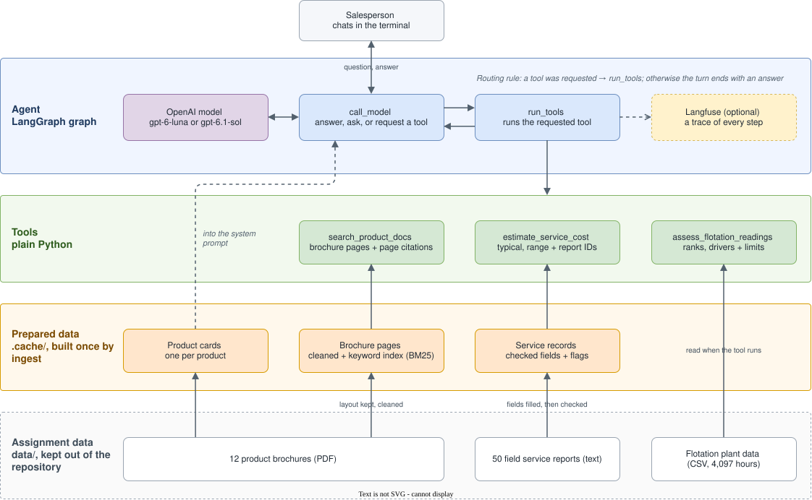

# Metso sales assistant agent

A command-line assistant for a Metso salesperson on a call with a mining customer. For each
message it decides for itself whether to answer, ask one short question, or use a tool, and
it says so when the answer is not in its data.

- **Products:** answers questions and recommends a product, from the brochures only.
- **Service costs:** estimates a field service visit, from past service reports only.
- **Flotation (optional part):** judges concentrate readings against plant history.



## What works so far

- Project skeleton: installs, lints and tests; `check` verifies the setup.
- Brochures read page by page with `ingest`: 73 clean pages, each tagged with its
  brochure, page and year. The PDF reader was picked by comparing six
  ([measurements](docs/TRACKER.md#measurements)).

The full plan, ticked off step by step: [docs/TRACKER.md](docs/TRACKER.md).

## Quick start

Needs [uv](https://docs.astral.sh/uv/), which also installs the right Python version.
Copy the assignment's `data/` folder into the repository root first (it is not part of the
repository), or point `DATA_DIR` in `.env` at it.

```bash
uv sync
cp .env.example .env              # then add your OPENAI_API_KEY
uv run sales-assistant check      # checks the data folder and the key
uv run sales-assistant ingest     # reads the brochures into .cache/
```

## Development

```bash
uv run ruff check                 # lint
uv run pylint src tests           # deeper lint
uv run ruff format --check        # formatting
uv run mypy                       # types
uv run pytest                     # tests
```

The same checks run on every push, in GitHub Actions.
