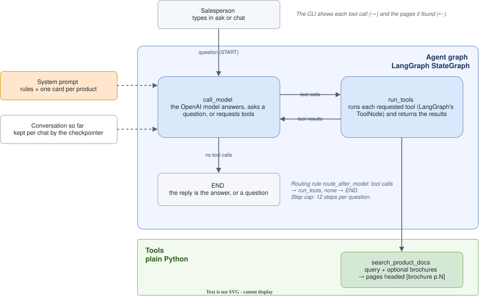
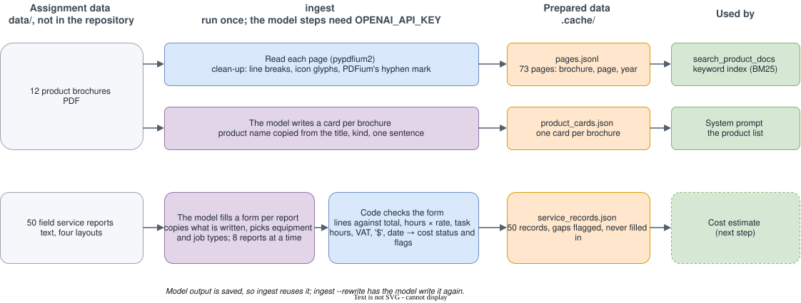
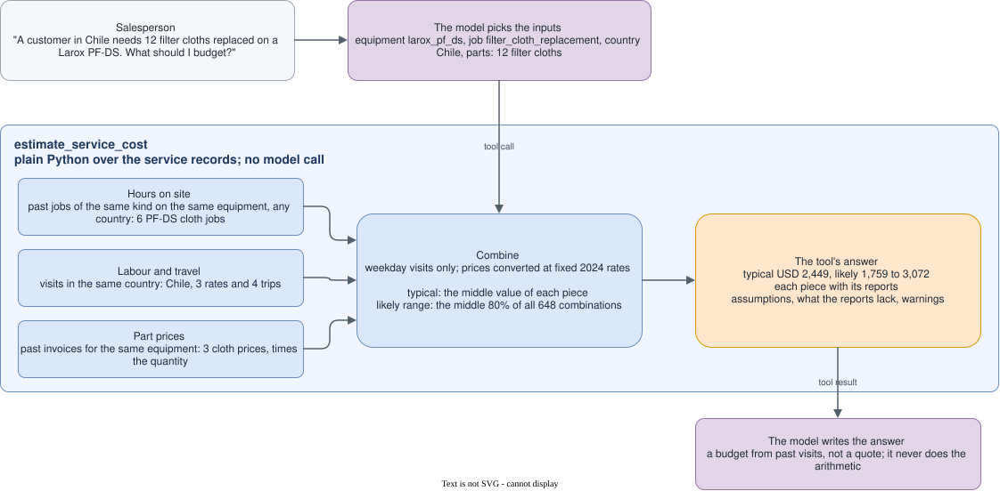

# Metso sales assistant agent

A command-line assistant for a Metso salesperson on a call with a mining customer. For each
message it decides for itself whether to answer, ask one short question, or use a tool, and
it says so when the answer is not in its data.

- **Products:** answers questions and recommends a product, from the brochures only.
- **Service costs:** estimates a field service visit, from past service reports only.
- **Flotation (optional part):** judges concentrate readings against plant history.


## What works so far

- Project skeleton: installs, lints and tests; `check` verifies the setup.
- Brochures read page by page with `ingest`: 73 clean pages, each tagged with its
  brochure, page and year. The PDF reader was picked by comparing six
  ([measurements](docs/TRACKER.md#measurements)).
- Keyword search over the pages with `search`: best pages first, optionally within named
  brochures. 22 of 24 test questions find their answer page in the top 5.
- Product questions answered by a LangGraph agent with `ask` or `chat`: it searches the
  brochures, cites the pages it used, and says when they do not cover a question. At
  `ingest`, the model also writes a short card per brochure, so the agent knows which
  products exist.
- Optional tracing in Langfuse: each question is recorded as a trace (every model call
  with its prompt, tokens and cost, every tool call with its input and result), and a
  chat's questions are grouped as one session.
- Service reports turned into checked records at `ingest`: the model fills a fixed form
  per report, and code checks the sums and hours and flags every gap (a cut-off cost
  table, VAT included, a currency written only as "$") without filling it in. Nine
  reports checked by hand test the extraction.
- Service visit budgets with `ask` or `chat`: the agent calls `estimate_service_cost`, which
  builds the budget in code from past visits and returns a typical figure, a likely range
  and the reports behind each number; `estimate` shows the same without the model.
- Flotation readings set against one plant's hourly history (the optional part): how often
  the plant did as badly, its typical values, which measurements differed between its good
  and poor hours, and the limits of that data; `assess` shows it without the model.

The full plan, ticked off step by step: [docs/TRACKER.md](docs/TRACKER.md).

## How the agent works



Each question runs a two-step loop. `call_model` sends the model the system prompt (rules
and the product cards), the conversation so far and the tool descriptions; the model
answers, asks a question, or requests tools. The routing rule, `route_after_model`, sends
tool requests to `run_tools` and otherwise ends the turn; tool results go back to the
model. The CLI prints every tool call, so each routing decision is visible.

## How the data is prepared



`ingest` runs once. Brochure pages are read with code alone; the model writes a card per
brochure and fills a form per service report, and code checks every form. What the model
writes is saved, so later runs reuse it, and `ingest --rewrite` writes it again.

## How a cost estimate is built



No past visit matches a new one exactly, so the budget is built from pieces: hours on site
from past jobs of the same kind, labour and travel from visits in the same country, and part
prices from past invoices. The typical figure takes the middle value of each piece; the
likely range is the middle 80% of every combination of past values. Weekend and emergency
visits are left out, and a piece the reports lack is named, never filled in.

## Quick start

Needs [uv](https://docs.astral.sh/uv/), which also installs the right Python version.
Copy the assignment's `data/` folder into the repository root first (it is not part of the
repository), or point `DATA_DIR` in `.env` at it.

```bash
uv sync
cp .env.example .env              # then add your OPENAI_API_KEY
uv run sales-assistant check      # checks the data folder and the key
uv run sales-assistant ingest     # prepares brochure pages, product cards and service records
uv run sales-assistant search "filter performance when the feed changes"
uv run sales-assistant ask "We have Larox pressure filters but performance drops whenever our feed grade changes"
uv run sales-assistant ask "A customer in Chile needs 12 filter cloths replaced on a Larox PF-DS tower press. What should I budget for the service visit?"
uv run sales-assistant estimate larox_pf_ds filter_cloth_replacement Chile --part "filter cloth" --quantity 12
uv run sales-assistant ask "The customer is getting 3.1% silica and 64.5% iron in their concentrate. They think that's normal. What do you think, and what could we suggest?"
uv run sales-assistant assess 64.5 3.1     # iron %, silica %
uv run sales-assistant chat       # a conversation; type exit to leave
```

### Tracing (optional)

Run Langfuse locally, then put its keys in `.env`; without them, nothing is traced.

```bash
git clone https://github.com/langfuse/langfuse.git
cd langfuse && docker compose up -d   # then open http://localhost:3000
```

Create a project and its API keys there, fill in the three `LANGFUSE_` lines in `.env`, and
run `uv run sales-assistant check`, which confirms Langfuse accepts the keys.

## Development

```bash
uv run ruff check                 # lint
uv run pylint src tests           # deeper lint
uv run ruff format --check        # formatting
uv run mypy                       # types
uv run pytest                     # tests
```

The same checks run on every push, in GitHub Actions.
